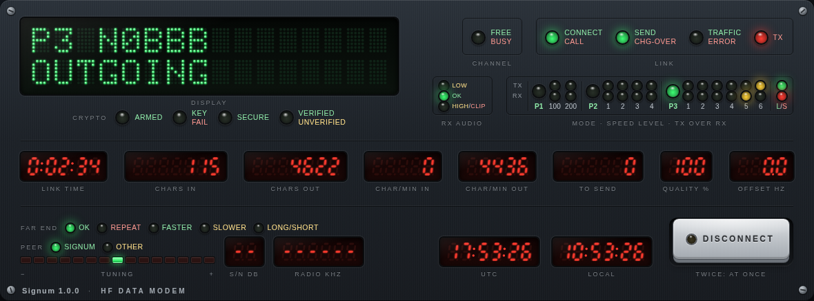

# Signum

**A P1/P2/P3 HF data modem in software, for Linux.**

Signum turns a Linux computer with a sound card into an HF data modem
for P1, P2 and P3 links, the protocol family widely used for e-mail
over HF radio. Host programs such as Pat (Winlink) use it through a
virtual serial port exactly as they would a hardware modem of the
classic class (terminal commands and WA8DED/CRC host mode). You watch
and drive it from a browser GUI modelled on a hardware front panel, a
terminal front panel, telnet or a WebSocket. It runs on anything from
a Raspberry Pi 4 up (though note that you WILL need a heat sink and a
fan on a Pi 4 - without it, the code will start shedding functionality
as the CPU starts to overheat until it finally just stops responding
to incoming transmissions until the CPU cools again).



Memory requirements for running the modem are very modest. Even the
smallest Pi 4 will run it without issue. It does, however, require a
fairly substantial amount of CPU. Don't expect to run the modem
successfully on a Pi 4 with a GUI desktop and web browser up and
running. The code utilizes multiple cores in order to encode and
decode packets within the tight tolerances required, and requires the
process to run with realtime priority in order to not miss
packets. Because of this, I'm doubtful this code can be successfully
ported to Windows, though feel free to prove me wrong.

Don't try to build this code on a low-RAM Pi 4. While it runs well
with very little memory, compiling the code is a substantial
task. Either cross-compile from a big x86-64 system or at least build
it on a bigger Pi. You could grow old and die waiting for this to
build on a Pi with 2 gig of RAM. This code has not been tested on a Pi
3, but is incredibly unlikely to run there. The CPU requirements are
already extremely tight on a Pi 4 (within a few percent).

Note that timing is incredibly critical with this modem (it's the
protocol itself, not the implementation). Shifting a reply by plus or
minus two milliseconds can be the difference between success and
failure. Thus far, I've only been able to make the modem work
successfully using an IC-7300 with the built-in USB soundcard and RTS
TX keying. Will it work with a Digirig or a SignaLink and another
radio? I won't rule out that it can't be done, but I haven't managed
it yet. I've tried with a KX2, an FT-817, and an FT-891. Thus far, I
simply cannot switch TX/RX within the tight tolerances required. There
is still work to be done there. I'd be surprised if the modem didn't
work correctly with other Icom models, such as the IC-705, IC-7200,
IC-7610, etc., as they share similar TX/RX characteristics.

## Features

- **P1, P2 and P3 ARQ links**, every speed level, short and long packets,
  Huffman and PMC compression, memory ARQ; automatic speed changes,
  break-in and changeover. Defaults match the reference hardware's.
- **Changeover as on the reference unit:** in a keyboard QSO each side
  hands over with **Ctrl-Y** (host mode `%O`/`%I`); text typed while
  receiving waits for it.
- **Automatic changeover** (`PDuplex 1`, GUI "Auto
  break-in") breaks in whenever text is waiting and hands over whenever the
  text has run out, in every mode: what a gateway or peer-to-peer host
  program that answers calls needs (off by default, as on the reference
  unit: [gateways and listeners](docs/md/connections.md#running-a-gateway-or-peer-to-peer-listener-set-pduplex-1)).
- **Unproto** (broadcast) in every mode, including P3; **Listen mode** to
  follow other stations' QSOs.
- **Host-mode serial port** (a pty) for Pat and other host programs:
  terminal mode with the classic command set, WA8DED host mode with and
  without CRC.
- **Browser GUI**: a hardware-style front panel (lamps, seven-segment
  readouts, tuning row, UTC and local clocks), receive waterfall, every
  setting on one Configure tab (live, or kept in a settings file for the next
  start), a terminal, the log. Self-contained, works offline.
- **Terminal front panel (TUI)** for SSH sessions, a **telnet** command
  interpreter (port 3000), a **WebSocket command shell** and a **JSON
  WebSocket API** (port 8770) for your own programs.
- **PTT** by RTS or DTR, Icom CI-V, or Hamlib's rigctld; a key-down watchdog
  that is always on, and a check that unkeys a radio held keyed by a second
  keying path. Optional **tuning** before each new call for an
  automatic antenna tuner (off by default): the radio's own tune cycle through
  rigctld when the rig supports it, else a steady tone.
- **Icom IC-7300 set-up in one step:** Signum finds the radio on USB, backs
  up its settings, sets its menus for Signum over CI-V (each setting read
  back; never its power or frequency) and fills in the sound card and PTT;
  a restore puts the radio back. Command line or GUI.
- **Self-calibration** of the audio path's timing and the sound card's clock
  error from normal links.
- **Made for small computers:** real-time priority, the CPU clock held up
  during links, a **CPU health** lamp (OK / BUSY / STARVED) that says what is
  late and what to do, and adaptive CPU features that drop expensive options
  level by level on a slow computer.
- **Optional encryption between two Signums, for non-amateur use only** (**illegal on the
  amateur bands**; built in only with `./configure --enable-encryption`, off until turned on,
  first use needs the `NOT-AMATEUR` acknowledgement): pre-shared keys or station key pairs
  (Noise IK/XX, AES-256-GCM, fresh keys every link for forward secrecy), checked by fingerprint
  or by an 8-digit SAS compared by voice; zstd compression with an English dictionary before
  encryption; never a fallback to clear text; a **Verify** mode proves the other station's key
  without encrypting. Not compatible with any other modem's AES ([Encryption](docs/md/encryption.md)).
- **Try it without a radio:** `signum-loopback` runs two stations joined by
  the ALSA loopback driver for testing, evaluation, and development (or just playing around).
- **Automatic Detection of a Signum Peer** Signum can detect when the
  modem on the other end is another instance of Signum and switch off
  bug emulation and use more modern compression or other features not
  implemented by the hardware manufacturer. This is indicated by an
  LED on the virtual front panel.
- **Improved Performance** All Signum features match hardware
  specifications at a minimum, but many features (sensitivity, etc)
  exceed the original hardware while remaining 100% compatible.

## Requirements

- Linux with ALSA. A Raspberry Pi 4 (64-bit OS) is the slowest supported
  computer; any current x86-64 machine works
  ([measured details](docs/md/performance.md#minimum-hardware)).
- To build: a C++17 compiler (g++ 12 or later), GNU make, the ALSA
  development files (`libasound2-dev` / `alsa-lib-devel`), and, only for an encryption build
  (`./configure --enable-encryption`), OpenSSL 3 and zstd
  (`libssl-dev libzstd-dev` / `openssl-devel libzstd-devel`), and `setcap`
  (`libcap2-bin`) for real-time priority. About 2 GB of memory for the
  compiler.
- Python 3 for the terminal front panel (standard library only).
- Package lists for Raspberry Pi OS, Debian, Ubuntu, Linux Mint, Fedora and
  Arch, and the optional extras (Hamlib's `rigctld`, Pat):
  [Installing](docs/md/install.md#packages-by-distribution).
- For a radio: a sound card or the radio's USB audio, and a PTT line (a
  serial port's RTS/DTR, CI-V, or rigctld). **Not VOX** ([why](docs/md/radio-setup.md#why-not-vox)).

## Quick start

On Debian, Ubuntu, Linux Mint or Raspberry Pi OS ([other distributions](docs/md/install.md#packages-by-distribution)):

```
sudo apt install g++ make pkg-config libasound2-dev libcap2-bin alsa-utils python3   # Debian, Ubuntu, Mint, Raspberry Pi OS
./configure && make                  # encryption is opt-in: libssl-dev libzstd-dev, then ./configure --enable-encryption
sudo make install                                                 # optional: runs from the source tree too
```

Try it with no radio: two stations on this computer.

```
signum-loopback                  # station A: http://127.0.0.1:8771/  station B: http://127.0.0.1:8772/
```

Open station A's GUI, connect to `TESTB`, type. `signum-loopback stop` ends
it.

With a radio:

```
signum-start --call N0CALL --alsa plughw:CARD=CODEC --ptt rts:/dev/ttyUSB0
```

then open **http://127.0.0.1:8770/** in a browser. The terminal shows the TUI;
quitting it stops Signum.

An **Icom IC-7300** needs nothing but its USB cable. Signum sets the radio
up itself (after a backup of its settings and your typed confirmation; never
its power or frequency) and fills in the sound card and PTT:

```
signum --configure-my-ic7300-and-overwrite-its-settings
signum-start --call N0CALL
```

(or **Configure » Radio & audio » Set up my IC-7300…** in the GUI;
[details](docs/md/radio-ic7300.md#zero-effort-set-up)). To use the radio with a hardware modem on its ACC socket instead, and back, there is a second
set-up ([details](docs/md/radio-ic7300.md#using-the-radio-with-an-external-modem-instead)).

Connect Pat: in Pat's `config.json`

```json
"pactor": {"path": "/tmp/ttysignum0", "baudrate": 57600, "rig": "", "custom_init_script": ""}
```

and `pat connect pactor:///CALL` (`pactor` is Pat's own name for this class
of modem).

## Documentation

The [user guide](docs/md/README.md):

- [Installing](docs/md/install.md) and [Getting started](docs/md/getting-started.md)
- [The GUI and the TUI](docs/md/gui.md)
- [Connecting programs](docs/md/connections.md): Pat, gateways and listeners (`PDuplex 1`), telnet, WebSocket, logins
- [Radio set-up](docs/md/radio-setup.md): sound card, PTT, levels, calibration;
  the [Icom IC-7300](docs/md/radio-ic7300.md) step by step
- [Modes and speed levels](docs/md/modes.md), [Console commands and host mode](docs/md/commands.md)
- [Hardware and performance](docs/md/performance.md): real-time priority, CPU clock, CPU health
- [Running Signum](docs/md/running.md) (systemd service), [Command-line options and the settings file](docs/md/options.md)
- [Troubleshooting and FAQ](docs/md/troubleshooting.md)

The same as PDF: the [user guide](docs/signum-user-guide.pdf), the [WebSocket API](docs/signum-websocket-api.pdf)
and the [man page](docs/signum.1.pdf) (`man signum` after installing); `make docs` rebuilds them
(needs pandoc, LuaLaTeX and groff: [docs/pdf/README.md](docs/pdf/README.md)). Developers: the
WebSocket protocol in [src/web/README.md](src/web/README.md).

## Compatibility

Signum interoperates over the air with PACTOR-1, PACTOR-2 and PACTOR-3
equipment, and its host interface is compatible with host software
written for the SCS PTC-II. Its defaults match the PTC-II's (one
deliberate exception: Signum's [peer
marker](docs/md/connections.md#the-peer-marker-is-the-other-station-a-signum),
which the PTC-II skips silently), and its console answers were checked
byte for byte against recordings of the PTC-II's firmware.  PACTOR,
SCS and PTC-II are trademarks of their respective owners (SCS GmbH &
Co. KG). Signum is not affiliated with, endorsed by or supported by
them; do not ask them for help with it. Apart from this section and
the paragraph on the Python SDK, this project calls that hardware "the
reference unit" and its firmware "the reference firmware", and the
modes P1, P2 and P3 in order to avoid infringing on Trademarks.

## The Name

Signum (Latin noun, neuter) has the formal English meaning:

A sign, mark, signal, token, or indication.In classical Latin it
refers to anything that conveys meaning or serves as a signal — a
visual mark, a standard or banner, a military signal, a token, or an
omen. The English words “sign,” “signal,” and “signature” are all
derived from it.In a technical or communications context, the most
natural English rendering is simply “signal.”

## Development

This code was developed over the course of roughly a thousand hours
with significant AI assistance and several very good DSP books, online
references, tutorials, and more than a few youtube "DSP How-To"
videos. It was developed on Omarchy Linux and tested on Omarchy, Mint,
and RaspberryPiOS. You should be able to build it on any modern Linux
(details elsewhere in this document).

The project began with reading and analysis of documentation provided
by the original developer. They've published multiple documents over
the years describing the internals of the P1, P2, and P3 protocols
with a fair amount of detail, though leaving out key
information. Recordings of both successful and unsuccessful QSOs were
made and carefully analyzed to first learn about the waveforms, then
about the data encoded in those waveforms.

The original hardware modems from the 1990s were fairly simple
devices. They consisted of a 68360 (a specialized version of the
Motorola 68K CPU) and a 56156 DSP chip, plus an audio CODEC and a
bunch of LEDs on a front panel. I used the MAME framework as a
starting point, added the missing 68360 instructions to the existing
MAME 68020 core, then modified the 56156 MAME core to add instructions
that the original MAME author didn't bother to implement (the firmware
kept crashing, so each time it crashed, I found another missing
instruction I had to implement). Eventually, the stock firmware booted
and ran.

Once I had a virtual version of a modem, development moved more
quickly. I could then test the virtual modem against a real modem and
work out the remaining timing issues. Figuring out the LED "wiring"
was a major obstacle, and took significant time comparing the physical
and virtual displays under varying connections and conditions. Once
the virtual modem was 100% compatible with a physical modem,
development improved again. The virtual modems weren't tied to the
real world, so I could run two against each other faster than real
time. This allowed for more test cycles in a given amount of wall
clock time. Once two virtual instances of the modem proved to be 100%
compatible, development moved on to the C++ code in this repository,
with periodic checks against a physical modem. These checks mostly
revealed timing issues that had to be addressed. The protocol is
incredibly strict, often succeeding or failing in single-digit
milliseconds of timing changes.

Having the virtual modem was priceless for testing the C++ code. As
with the earlier virtual-to-virtual testing, time could be "sped up"
and tests run sometimes as much as 10x normal speed. Combined with
assistance from AI in producing test cases (as well as various coding
tasks), an encouraging level of progress was made. When trying to
track down elusive details of a protocol implementation, being able to
test a thousand variations of a waveform or bit pattern in an
automated way overnight was very useful. In all, in excess (possibly
in significant excess, as I lost count of emulator runs mid-way
through development) of 30,000 emulated QSOs were run over an ALSA
audio loopback to figure out the protocol and track down bugs in my
code. Incidentally, I found about half a dozen bugs in the
manufacturer's firmware over the course of building this code. This
code emulates all of them, though a few have a build-time option to
"fix" them virtually. Leave them on for full compatibility.

30,000+ cycles of black-box testing have located the vast majority of
bugs, backed up by tests against a physical modem and dozens of
Winlink mail transfers. That said, there's no way to know that all of
the incompatibilities and bugs have been found. A noise glitch at just
the right time in a real QSO could still send the modem off to
Never-Never Land as happened so many times in development.

This code implements P1, P2, and P3. P4 was not attempted. P1 was
fairly easy. It's been implemented by a dozen modem manufacturers in
both hardware and software over the last 30 years. Counterintuitively,
P3 was easy relative to P2. Getting P2 right took significantly more
effort and P3. I've only taken a cursory look at P4, and it's not
clear I'm going to attempt it at this time. P3 is fast enough, and I'd
like to move on to other projects. I've seen nothing that indicates P4
is not possible, I'm simply losing motivation to spend another six
months on this project at this time.

## Licence

Copyright (C) 2026 Jeff Francis, N0GQ.

Signum is free software: you can redistribute it and/or modify it under the
terms of the GNU General Public License as published by the Free Software
Foundation, either version 3 of the License, or (at your option) any later
version (`GPL-3.0-or-later`). It is distributed in the hope that it will be
useful, but WITHOUT ANY WARRANTY; without even the implied warranty of
MERCHANTABILITY or FITNESS FOR A PARTICULAR PURPOSE. See [COPYING](COPYING)
for the full text.

## Third-party software

| Component | Licence | How Signum uses it |
|---|---|---|
| ALSA library (libasound) | LGPL-2.1-or-later | sound card access; dynamically linked |
| GNU C++ standard library (libstdc++), GNU C library | GPL-3.0 with the GCC Runtime Library Exception; LGPL-2.1-or-later | the C++ and C runtime; dynamically linked |
| Hamlib `rigctld` (optional) | LGPL-2.1-or-later / GPL-2.0-or-later | a separate program, reached over TCP for `--ptt rig` |
| websocket-client (Python, optional) | Apache-2.0 | the example shell client (`requirements.txt`); not needed to run Signum |
| Playwright (Python, optional) | Apache-2.0 | browser checks in the tests only |
| Pat (optional) | MIT | a separate program; the tests run it if installed |
| OpenSSL libcrypto 3 (for encryption) | Apache-2.0 | X25519, AES-256-GCM, SHA-256, HMAC, PBKDF2, random numbers; dynamically linked; only with `--enable-encryption` |
| zstd (libzstd, for encryption) | BSD-3-Clause (or GPL-2.0) | compression before encryption; dynamically linked; only with `--enable-encryption` |

The GUI loads nothing from elsewhere: no web fonts, no JavaScript libraries.
Signum's own code (the WebSocket server, SHA-1 and base64 for its handshake,
the JSON reader, the TUI's WebSocket client) is written for Signum.
