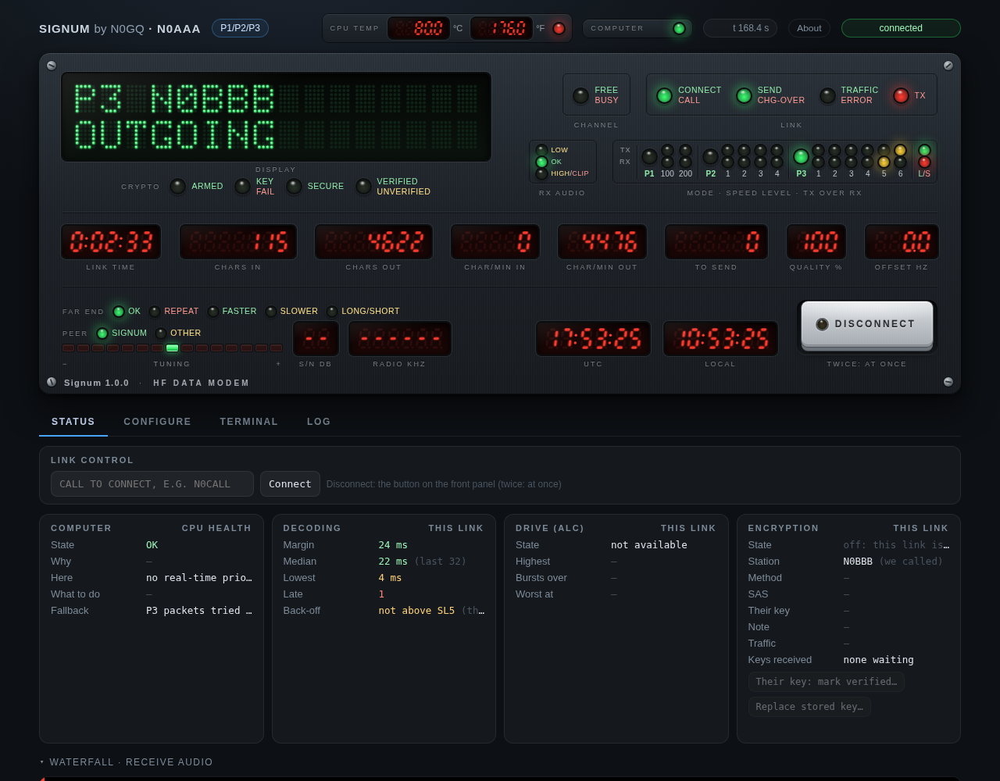
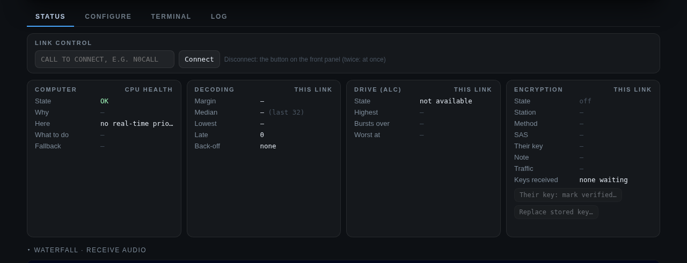
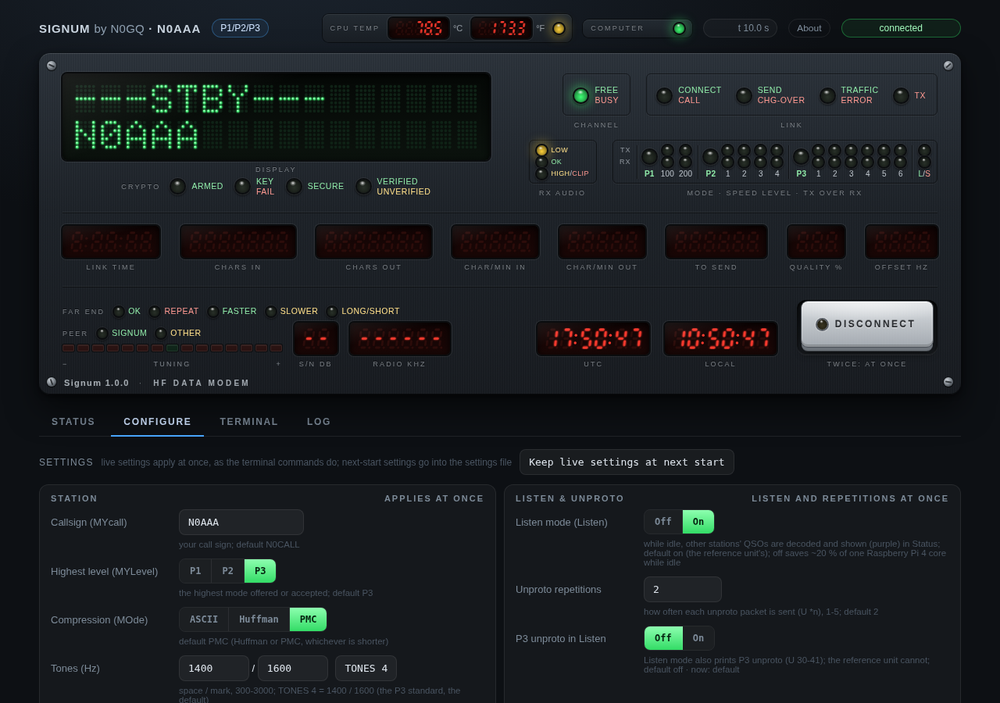
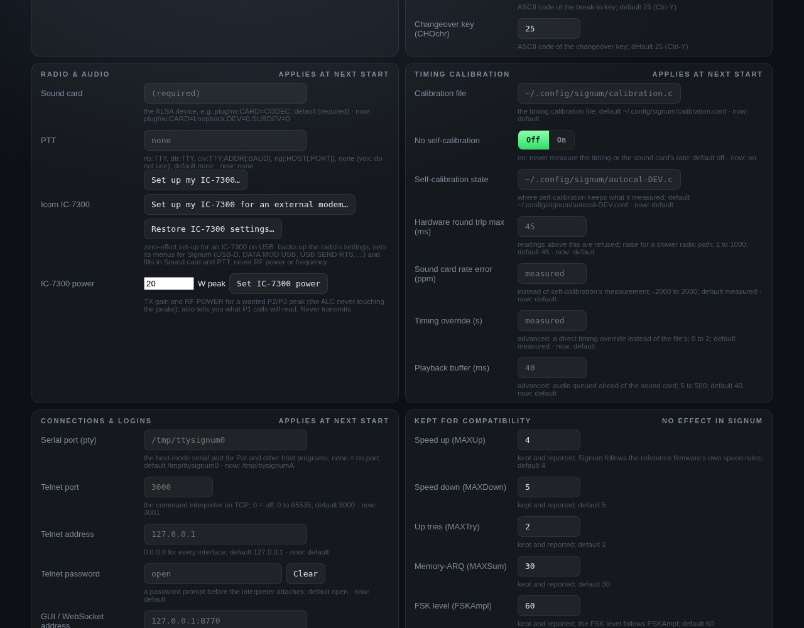
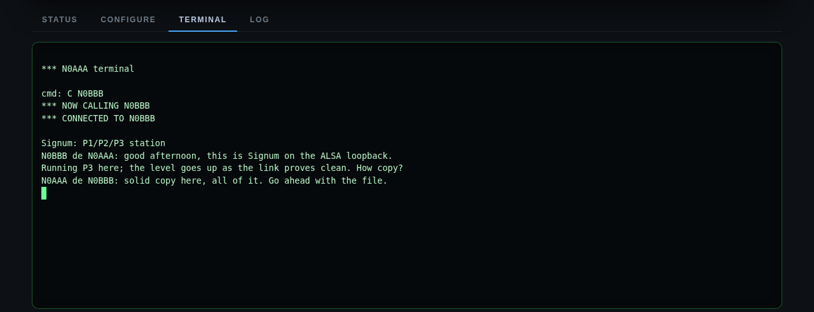
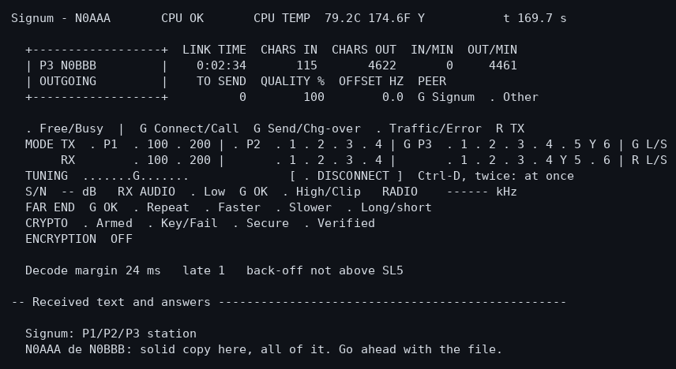

# The GUI and the TUI

Signum has two front panels that show the same thing: a browser GUI and a
terminal front panel (TUI). Both talk to Signum over its WebSocket port, so
any number of them can be open at once, on this computer or (if you allow it)
from another one. Signum runs the same with none open.



## Opening the GUI

Start Signum (`signum-start ...` or `signum ...`) and open

**http://127.0.0.1:8770/**

in any current browser on the same computer. The page loads nothing from the
internet; it works offline.

- `--ws ADDR:PORT` moves it (e.g. `--ws 127.0.0.1:9000`).
- By default Signum listens only on `127.0.0.1`, this computer. To open the
  GUI from another computer, either use an SSH tunnel
  (`ssh -L 8770:127.0.0.1:8770 radio-pi`, then http://127.0.0.1:8770/ on your
  own machine) or listen on the network with logins
  ([Logins and security](connections.md#logins-and-security)).
- `--no-ws` turns the GUI, the WebSocket API and the TUI's connection off.

The tabs can be opened directly: `#status`, `#config`, `#terminal`, `#log`
at the end of the address (http://127.0.0.1:8770/#terminal).

## The title bar

| Item | What it shows |
|---|---|
| **Signum · CALL**, **P1/P2/P3** | the program, your call sign and the modes |
| **CPU temp** | the computer's CPU temperature in °C and °F, with a lamp: amber from 70 °C, red from 80 °C. `--.-` when the system does not report a temperature |
| **Computer** lamp | CPU health: green OK, yellow BUSY, red and blinking STARVED. Hover over it (or tap it) for the reason. See [CPU health](performance.md#cpu-health-ok-busy-starved) |
| **t ... s** | Signum's own clock: seconds of audio since it started |
| **About** | version, build date and licence |
| connection pill | `connected`, or `disconnected · retrying` while the page cannot reach Signum (it reconnects by itself) |

## The front panel

The front panel is modelled on a hardware modem's: lamps, seven-segment
readouts, a two-line display and one button. Every lamp is always in the
same place with the same label; only lamps light up or go dark, and values
change only inside their windows. Explanations are in tooltips: hover over
any part.

**Display** (two lines of dot matrix): Signum's status text, such as
`---STBY---` (standby), `CALL N0BBB` (calling) or `P3 N0BBB` (linked in P3),
and below it `OUTGOING` (we called), `INCOMING` (they called), or our own call
in standby.

**Lamps:**

| Group | Lamp | Meaning |
|---|---|---|
| Channel | **Free / Busy** | in standby: green while the channel is free, red while someone is on it (the busy detector). Red for about 4 s after start-up. Dark during a link |
| Link | **Connect / Call** | green: linked; red: calling |
| Link | **Send / Chg-over** | green while we hold the sending direction; red during a changeover |
| Link | **Traffic / Error** | green: a packet with data received or acknowledged; red: nothing decoded |
| Link | **TX** | the transmitter is keyed |
| Crypto | **Armed** | green: encryption, or the identity check without encryption (verify), is on for this run (also in standby, so you see it before calling; the tooltip says which); dark: off |
| Crypto | **Key / Fail** | blinking amber: the encryption set-up is running (capability records, then the handshake); green: session keys agreed (verify: the other station's identity checked); red: the set-up FAILED (the link is ended, nothing was sent in clear or unverified; stays red after the link until the next link starts); steady amber: a public key received over the air waits for review (Configure tab) |
| Crypto | **Secure** | green: this link's traffic is encrypted; dark: no encrypted session (a verified link with verify is dark too: its data goes in clear) |
| Crypto | **Verified** | green: the other station's key is verified (you compared the fingerprint or the SAS), or it proved it holds the pre-shared key set for that station alone; amber (labelled Unverified): not verified (first contact, a key accepted unverified, or the shared `*` pre-shared key); dark: no encrypted session |
| Peer | **Signum** | green: the other station is a Signum: it sent Signum's peer marker or its encryption record on this link (the tooltip names its version). Lit with the marker on or off here |
| Peer | **Other** | amber: the peer marker is on here and the other station has sent 64 characters with no marker: **not a Signum with its marker on**, most likely the reference unit or another P1/P2/P3 modem. Inferred, not proven: an older Signum or one with its marker off looks the same. Turns to Signum if a marker comes later |
| Mode · speed level | **P1** `100 200`, **P2** `1 2 3 4`, **P3** `1 2 3 4 5 6` | the mode in use lights green, its speed level amber ([Modes and speed levels](modes.md)). Two rows of speed lamps: **TX** on top, the level this station sends at; **RX** below, the level the other station sends at. In P3 each direction picks its own level from how well the far end hears it, so the rows often differ. P2 keeps one level: its TX row shows the level last sent at, or now expected. The mode lamp sits once, between the rows |
| Mode · speed level | **L/S** | one per row, after the P3 lamps: green, long packets that way; red, short packets; dark in standby, during the P1 phase and on a P1 link |
| RX audio | **Low** | amber: the receive audio is too quiet (RMS under -60 dBFS): turn the radio's audio output or the sound card's capture level up |
| RX audio | **OK** | green: the receive audio level is fine |
| RX audio | **High / Clip** | amber (High): peaks above -3 dBFS, little headroom left: turn it down a little; red (Clip): samples at full scale in the last 2 s, the sound card is overloaded and the signal distorted: turn it down. Details below, [Receive audio level](#receive-audio-level) |
| Far end | **OK** | green: the other station received our last packet |
| Far end | **Repeat** | red: the other station did not get our last packet and asks for it again (or a speed change did not work and the link goes back) |
| Far end | **Faster** | green: it received the packet and asks for the next speed level up: it hears us well (P1: 200 Bd) |
| Far end | **Slower** | amber: it has been missing packets and asks for a lower speed level; the packet goes again, slower (P1: 100 Bd) |
| Far end | **Long/short** | amber: it received the packet and asks to switch between long and short packets (P2, P3; the L/S lamp on the TX row then shows which we send) |

The **Crypto** lamps are one row under the Display. The **Crypto** group is there only in a build with encryption (the page adds it when Signum
says it has encryption); a build without encryption (the default) has no Crypto group at all, and its panel is
exactly as it was before the group existed. Each Crypto lamp's tooltip has the detail: the method
(Noise pattern and keys), the SAS, the failure reason, the other station's key and what to do. On a
phone, tap a lamp to see its tooltip (tap again, or anywhere else, to close it); this works for the
Computer lamp too. More in [Encryption](encryption.md#the-front-panels-crypto-lamps).

The **Far end** lamps show how the other station hears us: while we send, it answers every packet with a short
control signal, and the lamps show what its last answer meant, in words. They are dark while we receive, in
standby, and in a cycle where no answer was heard (our receiving problem, or its; the Traffic/Error lamp is then
red). OK lights with Faster and with Long/short (those answers also take the packet); Repeat lights with Slower.
Signum reads the same answers as the reference unit (P2 and P3 use one set of five control signals, P1 its own
four); which signal means what depends on the one before it (two take turns as "received": the same one twice
asks for a repeat), so the panel shows the meaning Signum took, not the signal. In the two-column panel (wider
than 1100 px) they are one row over the Tuning display; in the one-column panel a box in the lamp block.

The **RX audio** lamps are a small box in the lamp block: left of the Mode group, or beside the Link group,
depending on the width.

The **Peer** lamps sit just above the Tuning display, below the Link time row of readouts, in every build. Both are dark in
standby, on a P1 link (P1 has no room for the marker) and until the other station is known; they never
move between standby and a link, and they take no room of their own (the panel is exactly as tall as
without them). More: [The peer marker](connections.md#the-peer-marker-is-the-other-station-a-signum).

**Readouts** (seven-segment, dark outside a link):

| Readout | Meaning |
|---|---|
| **Link time** | how long the link has been up |
| **Chars in** | characters received |
| **Chars out** | characters sent and acknowledged |
| **Char/min in** | characters a minute received, over the last minute of the link (from its start while it is shorter) |
| **Char/min out** | characters a minute sent and acknowledged, over the last minute (the old total, in plus out, is gone: the two directions run at different speeds) |
| **To send** | characters queued and not yet acknowledged |
| **Quality %** | good packets among the last 16 checked (P2 and P3); `---` on P1 and before the first check |
| **Offset Hz** | the other station's frequency offset from ours |
| **S/N dB** | the received signal-to-noise ratio, in a 3 kHz bandwidth, over the last 10 s; `--` when not measurable (standby, nothing from the other station in the last 10 s, below about -5 dB, or, while we send, no noise reference yet or one older than 15 minutes); `99` when the gaps between its bursts are digital silence (a test link: no noise to measure). Lit in standby too (as `--`). Below, [Received S/N](#received-sn) |
| **Radio kHz** | the radio's frequency, from the rig control the PTT uses (`--ptt rig:HOST:PORT`, rigctld): read every 2 s in standby, never during a call or a link (the last reading stays); `------` with no rig control, or when it does not answer. Read only: Signum never sets anything on the radio. 2 decimals below 10 MHz, 1 below 100 MHz |

The S/N and Radio kHz windows sit beside the Tuning display in the two-column panel and at the end of the readouts
row in the one-column panel. Nothing moves between standby and a link: every window keeps its width (the Link time
keeps its colons dark).

### Received S/N

Signum measures the S/N from the link's own cycle. An ARQ link alternates the other station's bursts (its
packets while we receive, its control signals while we send), our own transmissions (not measured) and short
quiet gaps. The audio is cut into 10 ms frames; for each, the power in the band 300-2700 Hz and over the whole
audio band. Frames during our transmission and for 20 ms after it are left out. Over the last 10.24 s the
frames fall into two groups by their band power (smoothed over 30 ms): the other station's bursts and the quiet
gaps; frames at a burst's edge are left out. Then:

- noise density = the mean band power of the quiet frames / the band's noise bandwidth (2.4 kHz, computed from the filter);
- signal = the mean power of the burst frames minus that of the quiet frames, over the whole band (so the
  band's edges do not cut the signal);
- **S/N = signal / (noise density × 3000 Hz)**: the usual "S/N in 3 kHz", as the emulator gates define their
  noise. In a 2.5 kHz bandwidth it would read 0.8 dB more.

Means are trimmed by 10 % at each end.

**While we send** an ARQ link has no gaps: on air each 1.25 s cycle is about 1 s of our packet, about 70 ms of silence
while the radio's receiver comes back, and about 0.2 s of the other station's control signal, and our next packet follows
at once. The silence is not noise (the radio's audio is near zero there, far below the band noise), and there is no other
quiet time. So Signum keeps a **noise reference** from the times it can measure the noise, and measures the other
station's signal against it:

- **Idle in standby** (no call, no link): the audio in 1-second blocks; the reference is the block at the lower quartile
  of the last 30 (a signal now and then raises a block, not the quartile); at least 5 s of listening.
- **The gaps of a link while we receive**: the quiet group above; the newest measurement is the reference (a receive
  phase of the link refreshes it).
- **Age:** the reference is used for **15 minutes**; after that the S/N shows `--` until a new one is measured (the HF noise
  changes with the band, the time of day and the antenna's surroundings; this is a judgement, not a measurement). Its age
  and where it came from are in the S/N window's tooltip (nothing on the panel changes); the panel JSON has `snr_src`,
  `snr_ref_s` and `snr_ref_kind` (src/web/README.md).
- While we send (more than half of the last 10 s is our own transmission) frames count as noise only from 150 ms after our
  transmission (on air the audio was back 70 ms after it; 150 ms covers it with a margin), so the radio's silence never
  counts as noise. Our signal's own frames may start 20 ms after it. Receiving, the guard stays 20 ms.
- The other station's signal is then taken from the frames not in the radio's silence (above 12 dB under the reference, five
  in a row): signal = their mean whole-band power minus the reference's, over the reference's noise density in 3 kHz.
  Below -5 dB it is `--`. If that window also has real gaps (noise-only frames, bimodality D of 5 or more) only the upper
  group counts as signal. Silence 30 dB or more under the reference never counts as noise, receiving either.

**It is an estimate.** The radio's AGC lowers the receiver's gain while it hears a signal, so the noise in the link
can be far below the noise measured in standby (on air: the band noise fell by 15 dB or more between standby and the
link's gaps). A sender that measures against the standby reference therefore reads **low** until the link has had a
receive phase, whose gaps give a reference taken under the link's own AGC. The tooltip says which one is in use
("idle in standby" or "in this link's gaps"). Fading and a changing AGC also move the real noise between the
reference and now, in either direction.

It is measured only; nothing in the modem uses it (decode results are
the same with it).

**Accuracy** [measured, 2026-11-22]: against links with known white noise,

| Test | Range | Result |
|---|---|---|
| synthetic bursts in the P2, P3 and P1 cycles | 0-30 dB | worst error 0.3 dB; 40 dB reads above 36 |
| two Signum stations in lockstep, P2 and P3, receiving and sending | 0-27 dB | median error -0.8 to +0.8 dB, worst 1.7 dB |
| synthetic sending cycle as on air (our packet, 70 ms of silence, 0.2 s of the other station's signal, no gap), noise reference from 10 s of standby | 0-20 dB | worst error 0.3 dB |
| the reference unit's emulator sending to Signum, the gates' noise scenarios (`SNR_LOG=1`), truth from the unit's measured transmit RMS and the noise added | -3 to 11 dB | P1 0.0 dB reads +0.2; P2 3.0 reads 3.2; P3 5.6 reads 6.2, 11.3 reads 12.1; P2 -3.0 reads -2.1 (and `--` in 9 of 12 readings: at the edge of what can be told apart) |

While we send, the reading is the other station's control signals, and some stations send those louder than
their data (the reference unit: about 3.5 dB), so the reading can step at a changeover. The measurement assumes
the noise is the same in the gaps as under the bursts: noise that comes with the other station's own signal
(its transmitter's noise floor) counts as signal. Fading over a few seconds spreads the readings; the 10 s
window smooths it. Below about -5 dB the two groups are no longer told apart and the readout shows `--`.

### Receive audio level

From the sound card's input samples, while we are not transmitting: the peak and the RMS of each second, the peak
held for 2 s, against full scale (32768, 0 dBFS; a sine at full scale has an RMS of -3 dBFS). Its tooltip shows both.

- **Clip** (red): a sample at 32000 or more (-0.2 dBFS) in the last 2 s. The converter is at its limit: clipped
  peaks spread the signal across the band and break the phase of P2 and P3.
- **High** (amber): a peak above -3 dBFS. P3 peaks run several dB above its RMS (it is many carriers), and
  fading or the radio's AGC swing them by more: under 3 dB of headroom, the next strong signal clips.
- **OK** (green): between.
- **Low** (amber): RMS under -60 dBFS (about 33 of 32767). The sound card's own noise (around -80 to -90 dBFS on
  a USB codec) and its 16-bit steps then come within 20-30 dB of the band noise and cost S/N on weak signals.

A good setting: band noise around -40 to -30 dBFS (RMS) with the radio's AGC on; a strong P3 signal then still
peaks under -3 dBFS.
**Tuning row:** 15 LEDs, 5 Hz each, the middle one for no offset; it turns
red past 10 Hz. A small offset is normal and followed automatically. After a
sudden jump of the other station's frequency during a link (a retune), Signum
measures the new offset and follows it within about two failed packets, up
to about ±70 Hz on P3 data and ±90-100 Hz on P2.

**Clocks:** **UTC** and **Local** time, 24-hour, from the browser's own
clock (they run even while the connection is down). "Local" is the
browser's time zone, which differs from the station's when you open the GUI
from elsewhere; the tooltip names it.

**Disconnect button:** one press is an orderly disconnect (`D`): Signum
sends what is queued, then ends the link. Its lamp is lit while that
disconnect is in progress; a second press then drops the link at once (`DD`).
It also stops a call in progress. With no link and no call it does nothing.

## Status tab



- **Link control:** type a call sign and press **Connect** (the same as
  `C CALL`). Disconnecting is the front panel's button.
- **Computer** card (CPU health): **State**, **Why** (what was late in the
  last minute), **Here** (standing causes on this computer: no real-time
  priority, a CPU clock that cannot be held up or that Signum is told not to hold (`--cpu-clock off`), other load), **What to do**,
  **Fallback** (CPU-bound work `CPUadapt` leaves out while the computer is
  short: [CPUadapt](performance.md#adaptive-cpu-features-cpuadapt)).
- **Decoding** card, for the current or last link (a dash where nothing was measured):
  - **Margin**: how much time was left before our answer was due when the
    last received packet's decode finished. Green is comfortable, yellow is
    under 8 ms, red `late` means it was not done in time (the packet counts
    as failed and is sent again).
  - **Median** (last 32) and **Lowest** margin.
  - **Late**: decodes not done in time (with SL1 tries and break-ins).
  - **Back-off**: `not above SLn (the computer)` when this computer was too
    slow for higher P3 levels and Signum held the link lower.
- **Encryption** card (only in a build with encryption): this link's encryption or identity check: state (off, on, verify,
  setting up, **ENCRYPTED**, **IDENTITY VERIFIED · data in clear**, or **FAILED** with the reason; the link was ended, nothing was sent in
  clear), station, method, SAS, the other station's key, held data, traffic, keys received over the
  air waiting. Buttons: **Their key: mark verified…** and **Replace stored key…** (after a link failed
  because the other station presented a key other than the stored one). Every row in
  [Encryption](encryption.md#in-the-gui). On a link made by signum-chat or signum-sync, the protection is the one chosen in that
  program, which overrides the Configure tab's Encryption setting for that link (its tooltip says so).
- **Waterfall · receive audio:** what the modem hears. **Span** (0-4000,
  300-2700 or 1000-2000 Hz), **Range** (20-90 dB of contrast), **Speed**
  (slow, normal, fast). The station's two FSK tones are marked; a red mark
  at the left edge shows rows heard while we were transmitting.
- **Links · this run:** each link since Signum started, newest first: when,
  station, role (caller or callee), mode, best and last level, duration,
  characters in and out. Not kept across restarts.
- **Received text and commands:** received link text; the line below sends
  either a **terminal command** (e.g. `MYcall`, `MYLevel 2`, `C N0CALL`, `D`)
  or, switched to **Send text**, text for the link. In Listen mode, other
  stations' QSOs appear here too (in purple).

## Configure tab



Every user setting Signum has is on this tab (the command-line options and
the setting commands; only the test options and the actions such as `C` and
`D` are not). Each field has its range, its default and a one-line hint.
Each card says when its settings apply:

- **applies at once** (live): the change is made at once, exactly as the same
  terminal command would, and every open GUI, the TUI and the serial port see
  it. Live settings are not saved by themselves (as on the reference unit):
  the next start begins again from the defaults, the settings file and the
  command line. **Keep live settings at next start** (top of the tab) writes
  the live settings that have a start-up option into the settings file.
- **applies at next start**: the setting cannot change while Signum runs (the
  sound card, the ports, ...). It is saved in the
  [settings file](options.md#the-settings-file) as you change it, and the
  next start uses it. Below each such field, **now:** shows what this run
  uses. Emptying a field (or choosing its default) removes it from the file.
  The command line overrides the file.

**Station** (at once):

| Setting | Command / option | Range | Default |
|---|---|---|---|
| Callsign | `MYcall`, `--call` | a call sign | N0CALL |
| Highest level | `MYLevel`, `--mylevel` | P1, P2, P3: the highest mode offered or accepted | P3 |
| Compression | `MOde` | ASCII, Huffman, PMC | PMC |
| Tones (Hz) | `TOnes`, `MARk`, `SPAce`, `--tones` | 300-3000; **TONES 4** = 1400 / 1600 Hz, the standard | 1400 / 1600 |
| Connect text | `CMsg` | 0-2: the text sent when we are called and the link is P3; 0 = none | 1 |

**Listen & unproto:**

| Setting | Command / option | Range | Default | Applies |
|---|---|---|---|---|
| Listen mode | `Listen`, `--listen` | Off / On: other stations' QSOs decoded while idle (Off saves about a fifth of a Raspberry Pi 4 core while idle) | On (the reference unit's) | at once |
| Unproto repetitions | `U *n` | 1-5: how often each unproto packet is sent | 2 | at once |
| P3 unproto in Listen | `--p3-unproto-rx` | Off / On: Listen mode also prints P3 unproto (the reference unit cannot) | Off | next start |

**Peer marker** (from the next link):

| Setting | Command / option | Range | Default | Applies |
|---|---|---|---|---|
| Signum peer marker | `PEERmark`, `--peer-marker` | On / Off: a short system sequence on each P2/P3 link (never P1) that the reference unit skips silently, so that two Signums recognise each other (the Peer lamps); Off sends nothing extra | On (the owner's choice; the reference unit has none) | at the next link |

**ALC warning** (at once):

| Setting | Command / option | Range | Default | Applies |
|---|---|---|---|---|
| Warn when the radio's ALC acts | `ALCwarn`, `--alc-warn` | On / Off: while we send on a P2/P3 link, read the radio's ALC meter through rigctld (`--ptt rig:`) and warn once per link when it squashes the PSK peaks; Off reads nothing. Warns only, never changes the TX gain or power | On | at once |

The warning shows on the Status tab's **Drive (ALC)** card (this link: State, Highest ALC, Bursts over, and the worst one's mode, level and TX gain; always the same four rows, so nothing moves) and in the log as `[alc]`. It is not on the front panel. [ALC warning](radio-ic7300.md#alc-warning).

**Link parameters** (at once, or after the current link):

| Setting | Command / option | Range | Default | Effect |
|---|---|---|---|---|
| Timeout | `MAXErr` | 30-255 | 70 | bad cycles in a row before a link (or a call) is given up; 255 = never |
| TX delay | `TXDelay` | 1-31 (× 5 ms) | 4 (20 ms) | the FSK lead-in after keying |
| PSK level | `PSKAmpl` | 10-1000 mV | 140 | the output level ([Audio levels](radio-setup.md#audio-levels)) |
| TX gain | `--tx-gain` | -40 to 20 dB | 0 | on top of PSKAmpl (Signum's own) |
| Key-down watchdog | `--max-key` | 1-600 s | 90 | the key is dropped after this long keyed without a break |
| Auto break-in | `PDuplex`, `--pduplex` | Off / On | Off | Every mode. Off (the reference unit): text you type while receiving waits until the sender hands over or you press Ctrl-Y, and while sending Signum hands over only on Ctrl-Y. On: Signum breaks in by itself whenever text is waiting and hands over by itself whenever its text has run out ([Modes](modes.md#how-a-link-works-arq)). Turn it on for a station that answers calls unattended ([gateways and listeners](connections.md#running-a-gateway-or-peer-to-peer-listener-set-pduplex-1)) |
| Auto break-in hold | `PDTimer`, `--pdtimer` | 2-30 s | 12 | with auto break-in on: after the other station broke in, ours waits this long for its changeover |

**Tuning tone** (`TUnetone`, `--tune-tone`, `--tune-method`, `--tune-hz`, `--tune-db`, Signum's own; at once; [Tuning tone](radio-setup.md#tuning-tone)):

| Setting | Range | Default | Effect |
|---|---|---|---|
| Method | Auto / Tone / Radio | Auto | Auto: the radio's own tuner cycle through rigctld when the PTT is `rig:` and the rig supports TUNE, else the tone; Tone: always the tone; Radio: the radio's tune, the tone (reason in the log) when it cannot. The radio's tune transmits at the radio's RF POWER, not at the data level ([the radio's own tune cycle](radio-setup.md#the-radios-own-tune-cycle---tune-method)) |
| Duration | 0-10 s | 0 (off) | tuning before each new call we place: the tone's length, or the longest wait for the radio's tune cycle |
| Frequency | 300-2700 Hz | 1500 | the tone's frequency |
| Level | -30 to 0 dB | 0 | against the data level; 0 = the power of the P1 call packets |

While the tone sounds the TX lamp is lit; the **Disconnect** button stops it at once and the
call is not made.

**CPU & performance:**

| Setting | Command / option | Values | Default | Applies |
|---|---|---|---|---|
| Adaptive CPU features | `CPUadapt`, `--cpu-adaptive` | Adaptive / Off; the hint shows how far long P3 packets are used on this computer ([CPUadapt](performance.md#adaptive-cpu-features-cpuadapt)) | Adaptive | at once |
| CPU clock | `--cpu-clock` | auto / max / off ([CPU clock](performance.md#cpu-clock)) | auto | next start |

**Host interface** (at once; for host programs and the converse-mode keys):

| Setting | Command | Range | Default |
|---|---|---|---|
| Host-mode channel | `PTChn` | 1-31 | 4 (Pat sets 31) |
| Status reports | `STatus` | 0-2; 2 = the status byte sent by itself on every change | 1 |
| Escape key | `ESCchr` | ASCII code | 27 (Esc) |
| QRT key | `QRTChr` | ASCII code | 4 (Ctrl-D) |
| Break-in key | `BKchr` | ASCII code | 25 (Ctrl-Y) |
| Changeover key | `CHOchr` | ASCII code | 25 (Ctrl-Y) |



**Radio & audio** (next start): **Sound card** (`--alsa`), **PTT** (`--ptt`:
`rts:TTY`, `dtr:TTY`, `civ:TTY:ADDR[:BAUD]`, `rig[:HOST[:PORT]]`, `none`;
[PTT](radio-setup.md#ptt)).

**Icom IC-7300** (in the Radio & audio card; [Zero-effort
set-up](radio-ic7300.md#zero-effort-set-up)):

- **Set up my IC-7300…** opens a dialog. It looks for IC-7300s on USB at once
  and reads their settings (nothing is changed): the radio's serial number,
  port, sound card, CI-V address and rate, and a table of every setting with
  its present value and what Signum sets (changes in yellow). With more than
  one radio, choose one by its serial number. Under the table a red box holds
  the warning: the radio is about to be reconfigured, its present values will
  be lost from it, a backup is saved first and can be restored, the transmit
  power and frequency are not changed. **Reconfigure the radio** stays
  disabled until you tick **I understand my radio's current configuration
  will be lost**. Then each setting appears as it is written and read back
  (ok / FAIL), and at the end the backup file's name and the Sound card and
  PTT lines written to the settings file (they apply at the next start).
  **Back up only** saves a backup without changing anything; **Look again**
  repeats the search. If the radio does not answer at its port's present
  rate, a second checkbox lets Signum set the port's speed to find it
  (RTS/DTR rise for about a millisecond).
- **Set up my IC-7300 for an external modem…** is the same dialog for a
  hardware modem on the radio's ACC socket instead of Signum on USB (DATA MOD
  = ACC, USB SEND and USB Keying OFF, ACC MOD Level 50 %; the table's last column is headed
  "External modem"). It does not write the settings file, and says so:
  Signum cannot key the radio until **Set up my IC-7300…** is run again.
  Each set-up brings the radio back from the other
  ([Using the radio with an external modem](radio-ic7300.md#using-the-radio-with-an-external-modem-instead)).
- **Restore IC-7300 settings…** lists the backup files (newest first; radio
  serial number, number of settings). Choose one: the warning appears, tick
  the box, **Restore these settings**. A backup taken by **Set IC-7300 power**
  puts RF POWER and the USB MOD Level back too (its warning says so).
- **IC-7300 power**: the wanted P2/P3 peak power in watts and **Set IC-7300
  power** (`--ic7300-power`, `ICPower`). It reads the radio and sets the drive
  and RF POWER: the TX gain the model names for that peak, chosen so that the ALC
  stays at rest even on a hot radio (20 W gives -7 dB, 25 W -7.5 dB), the USB MOD Level back
  to 100 % if it differs, and RF POWER a limit just above the peaks, so the ALC
  stays at rest. The TX gain applies at once and is saved in the settings
  file; the answer (setting, peaks, P1 power, TX gain old → new, assumptions)
  appears under the button. A model, never a transmission: measuring on the
  air is `signum --ic7300-power W --measure` with Signum stopped (it needs
  the sound card the running Signum holds)
  ([Setting the power](radio-ic7300.md#setting-the-power)).

The station holds its transmitter unkeyed while the dialog works with the
radio (opening the radio's port clears its RTS and DTR lines, which the PTT
uses too), and every IC-7300 action refuses while a link is up.

**Timing calibration** (next start; [Timing calibration](radio-setup.md#timing-calibration)):
calibration file (`--cal`), no self-calibration (`--no-autocal`),
self-calibration state (`--autocal-state`), hardware round trip max
(`--autocal-max-ms`, 1-1000 ms, default 45), sound card rate error
(`--audio-ppm`, -2000 to 2000 ppm), timing override (`--rt-latency`, 0-2 s,
advanced), playback buffer (`--prime-ms`, 5-500 ms, default 40, advanced).

**Connections & logins** (next start; [Connecting programs](connections.md)):
serial port (`--pty`, an absolute path or `none`), telnet port (`--telnet`,
0 = off) and address (`--telnet-bind`), telnet password (`--telnet-auth`),
GUI / WebSocket address (`--ws`), no GUI / WebSocket (`--no-ws`), GUI login
(`--web-auth`), WebSocket login (`--ws-auth`), GUI directory (`--gui`), quiet
(`--quiet`). Passwords are never shown again: the field says "set (hidden)"
or "open", and **Clear** removes it.

**Kept for compatibility** (no effect in Signum): `MAXUp` 2-30 (4), `MAXDown`
2-30 (5), `MAXTry` 1-9 (2), `MAXSum` 5-60 (30), `FSKAmpl` 10-1000 mV (60).
Host programs send them; Signum keeps and reports them but follows the
reference firmware's own speed rules, and the FSK level follows the PSK level.

**Encryption** (five cards, only in a build with encryption; [Encryption](encryption.md#in-the-gui)
describes every control): the legal warning and the statement that it is not compatible with SCS
modems; encryption now and at next start (the first time each asks for the acknowledgement `NOT-AMATEUR`, which is then stored; Withdraw acknowledgement takes it back),
the identity check without encryption (Protection Verify, `--encryption verify`), sign every record (`--sign`, default off),
compression (`--encryption-compression`, default on), trust (`--encryption-trust`, and `--verify-trust` for verify), set-up timeout
(`--encryption-wait`), key directory (`--key-dir`, next start); this station's key pair (generate,
copy, save, send over the air, export the private key); import of key blocks; known stations
(verify by fingerprint, replace a changed key, export, delete, add) and keys received over the air (review, accept,
reject); pre-shared keys (generate, set, from a passphrase, export, delete).

**Settings file:** the file this run uses (none with `--no-config`), whether
it was read at this start, and the order (the file first, then the command
line). An answer that refuses a value (out of range, a malformed address) is
shown below it and nothing is written.

## Terminal tab



The command interpreter, exactly as on the serial port: the `cmd:` prompt,
every [console command](commands.md), `C CALL` to connect, then converse
(type text to send it).

- Click into the terminal and type. **Esc** gives one command line during a
  link, **Ctrl-D** an orderly disconnect (QRT), **Ctrl-Y** a break-in while
  receiving or a changeover while sending; the buttons do the same. In
  every mode text typed while receiving waits for the other station's
  changeover or Ctrl-Y, unless Auto break-in is on ([Modes](modes.md#how-a-link-works-arq)).
- **Local echo** (on by default, remembered by the browser): the
  interpreter does not echo what you type, so the page shows it itself.
- **Clear** empties the screen.

## Log tab

Signum's log, the same lines it writes to its terminal or log file (the last
500 lines are kept). **follow** keeps the newest line in view; **Clear**
empties the view.

## Logins

When Signum runs with `--web-auth USER:PASS`, the browser asks for that user
and password (HTTP Basic). With `--ws-auth USER:PASS`, the page shows a
**WebSocket login** box. See
[Logins and security](connections.md#logins-and-security).

## The TUI (terminal front panel)



```
signum-tui [ws://HOST:PORT/] [--auth USER:PASS]
```

`signum-start` runs it for you. On its own, from the source tree it is
`tui/signum-tui`; installed, `/usr/local/share/signum/tui/signum-tui`.
The default address is `ws://127.0.0.1:8770/`. It needs only Python 3
(curses); it works over SSH.

It shows the same front panel in character cells (display, readouts, lamps,
tuning row, Disconnect button), the CPU temperature and CPU health on the top
line (with the reason and what to do on two lines below while it is not OK),
the received text, and a command line (`cmd>`) that you edit locally. The `PEER` lamps (Signum,
Other) are beside the second row of readouts. In a build with encryption
an `ENCRYPTION` line under the tuning row shows its state ([Encryption](encryption.md#in-the-gui));
the `CRYPTO` commands work on the command line.

| Type | Does |
|---|---|
| a command and Enter | a terminal command (`MYcall`, `MYLevel 2`, `CPUadapt 0`, `C N0CALL`, `D`) |
| `>text` | sends `text` on the link |
| `/c CALL` | connect |
| Ctrl-D | the Disconnect button (`D`; again while in progress, `DD`) |
| `/d`, `/dd` | disconnect, disconnect at once |
| PgUp, PgDn | scroll the received text |
| Up, Down | command history |
| `/q` or Ctrl-C | quit (under `signum-start` this also stops Signum) |

`signum-tui --once` prints one frame as plain text and exits (for scripts).
